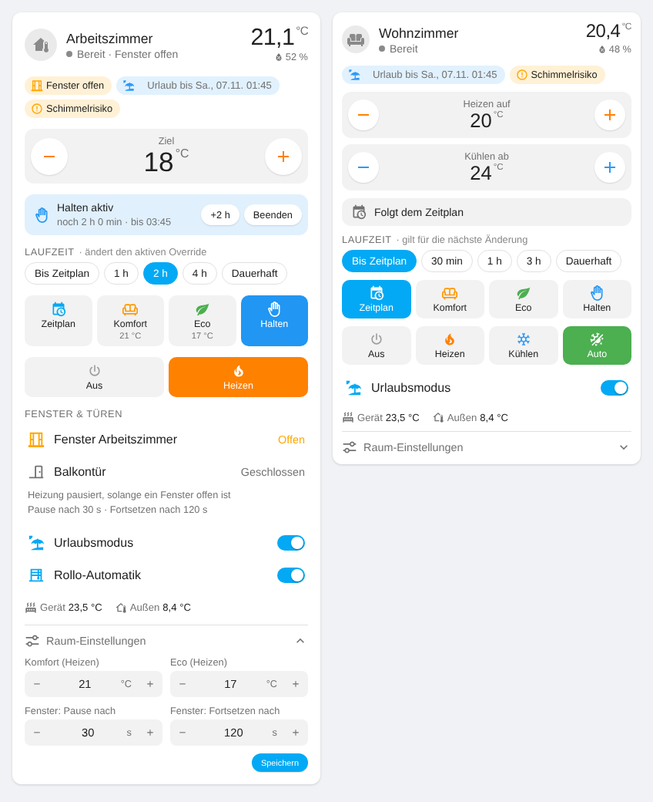
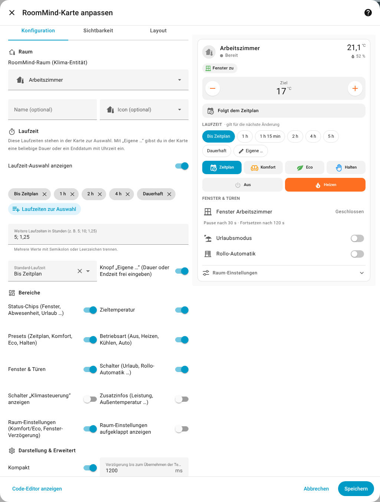

# RoomMind Card für Home Assistant

[](https://hacs.xyz/docs/faq/custom_repositories)
[](https://github.com/Ga-Re/RoomMindeHACard/actions/workflows/validate.yml)
[](https://github.com/Ga-Re/RoomMindeHACard/releases)

Eine Lovelace-Karte, mit der du Räume der Integration [RoomMind](https://github.com/snazzybean/roommind) steuerst
und überwachst: Zieltemperatur, **Laufzeit** eines Overrides, Presets, Betriebsart, Fenster/Türen, Urlaubsmodus,
Rollo-Automatik und die Komfort-/Eco-Temperaturen des Raums.



## Funktionen

- **Raumstatus:** Raumtemperatur, Luftfeuchte, was RoomMind gerade tut (Heizt/Kühlt/Bereit/Aus) samt Heizleistung.
- **Zieltemperatur mit + / −.** Im Auto-Modus (Heizen & Kühlen) gibt es zwei Regler: „Heizen auf“ und „Kühlen ab“.
  Die Änderung wird nach einer kurzen Pause übernommen, damit mehrere Klicks nur einen Befehl senden.
- **Laufzeit:** Wähle, wie lange eine geänderte Temperatur oder ein Preset gilt:
  *Bis Zeitplan* (bis zum nächsten Wechsel im RoomMind-Zeitplan), feste Zeiten wie *1 h*, *2 h*, *4 h*, *Dauerhaft*
  – oder **Eigene …**: dort gibst du eine beliebige Dauer (*Für* x Stunden y Minuten) oder einen
  **Endzeitpunkt mit Datum und Uhrzeit** (*Bis* morgen 06:45) ein.
  Ist ein Override aktiv, siehst du die **Restlaufzeit und Endzeit**, kannst ihn **verlängern** (+1 h …),
  durch Tippen auf eine andere Laufzeit **neu setzen** oder **beenden**.
- **Zeitplan:** wann der **nächste Zeitblock** beginnt und welche **Temperatur** dort gilt – direkt unter der
  Zieltemperatur („Nächster Block: 16:00 · 21 °C“) und als Liste der nächsten Zeiträume (Jetzt / Komfort / Block / Eco
  mit Uhrzeit und Temperatur). Berücksichtigt Block-Temperaturen (`temperature`, `heat_temperature`,
  `cool_temperature`), Komfort/Eco des Raums, die Einstellung „außerhalb des Zeitplans aus“ und einen
  Zeitplan-Wähler (`input_boolean`/`input_number`).
- **Presets:** Zeitplan, Komfort, Eco und Halten (aktuelle Temperatur halten), jeweils mit der Raum-Temperatur.
- **Betriebsart:** Aus, Heizen, Kühlen, Auto (je nachdem, was der Raum kann).
- **Status-Chips:** Fenster offen/zu, Urlaub (mit Enddatum), Abwesend, Raum leer, Schimmelrisiko,
  Schimmelschutz, pausierte Steuerung.
- **Fenster & Türen:** alle in RoomMind hinterlegten Fenster-/Türsensoren mit Zustand, Hinweis wenn die Heizung
  pausiert, und die Verzögerungen (Pause nach / Fortsetzen nach).
- **Schalter:** Urlaubsmodus, Rollo-Automatik (falls Rollos konfiguriert), optional Klimasteuerung; Rollo-Automatik
  nach manueller Verstellung wieder fortsetzen.
- **Raum-Einstellungen** (aufklappbar): Komfort- und Eco-Temperatur (Heizen/Kühlen) sowie die Fenster-Verzögerungen
  direkt in der Karte ändern.
- **Komplett per GUI einstellbar:** Jede Option hat ein Feld im visuellen Editor, YAML ist nie nötig.
- Deutsch und Englisch, helles und dunkles Theme, °C und °F.

## Installation

### HACS (empfohlen)

1. HACS öffnen → oben rechts **⋮** → **Benutzerdefinierte Repositories**.
2. URL `https://github.com/Ga-Re/RoomMindeHACard` eintragen, Typ **Dashboard** wählen, **Hinzufügen**.
3. **RoomMind Card** suchen, **Herunterladen** und den Browser neu laden.

HACS meldet neue Versionen automatisch.

### Manuell

1. `roommind-card.js` aus dem [neuesten Release](https://github.com/Ga-Re/RoomMindeHACard/releases/latest)
   herunterladen und nach `/config/www/roommind-card.js` kopieren.
2. **Einstellungen → Dashboards → ⋮ → Ressourcen → Ressource hinzufügen**:
   URL `/local/roommind-card.js`, Typ **JavaScript-Modul**.
3. Browser neu laden (ggf. Cache leeren).

## Konfiguration (ohne YAML)



1. Dashboard bearbeiten → **Karte hinzufügen** → unter *Benutzerdefinierte Karten* **RoomMind Card** wählen.
   Der erste RoomMind-Raum ist bereits ausgewählt.
2. Im Editor einstellen:
   - **Raum:** RoomMind-Raum (nur RoomMind-Klima-Entitäten werden angeboten), optional Name und Icon.
   - **Laufzeit:** Auswahl ein-/ausblenden, welche Laufzeiten als Knöpfe erscheinen, **weitere eigene Laufzeiten**
     in Stunden (z. B. `5; 10; 1,25`), Standard-Laufzeit und ob der Knopf **„Eigene …“** angezeigt wird.
   - **Bereiche:** jeden Teil der Karte einzeln ein- oder ausblenden.
   - **Darstellung & Erweitert:** Kompakt, Verzögerung bis zum Senden der Temperatur, RoomMind-Raum (falls die
     automatische Erkennung nicht klappt) und ein umbenannter Urlaubs-Schalter.
3. **Speichern** – fertig.

### Alle Optionen (zum Nachschlagen)

Der Editor schreibt diese Einstellungen selbst; von Hand musst du nichts eintragen.

| Option | Standard | Bedeutung |
| --- | --- | --- |
| `entity` | – | RoomMind-Klima-Entität des Raums |
| `name`, `icon` | aus der Entität | eigener Name / eigenes Icon |
| `durations` | `[schedule, 1, 2, 4, permanent]` | Laufzeit-Knöpfe in Stunden, dazu `schedule` und `permanent` |
| `default_duration` | `schedule` | vorausgewählte Laufzeit |
| `show_duration` | `true` | Laufzeit-Auswahl |
| `show_custom_duration` | `true` | Knopf „Eigene …“ (Dauer oder Endzeitpunkt frei eingeben) |
| `show_status` | `true` | Status-Chips |
| `show_target` | `true` | Zieltemperatur |
| `show_presets` | `true` | Zeitplan / Komfort / Eco / Halten |
| `show_modes` | `true` | Aus / Heizen / Kühlen / Auto |
| `show_schedule` | `true` | Zeitplan mit nächstem Block und Temperatur |
| `schedule_items` | `3` | Anzahl der angezeigten Zeitplan-Einträge (1–8) |
| `show_windows` | `true` | Fenster & Türen |
| `show_toggles` | `true` | Urlaubsmodus, Rollo-Automatik |
| `show_climate_control` | `false` | zusätzlich Schalter „Klimasteuerung“ |
| `show_info` | `true` | Leistung, Gerätesollwert, Außentemperatur |
| `show_settings` | `true` | Raum-Einstellungen (Komfort/Eco, Fenster-Verzögerung) |
| `settings_open` | `false` | Raum-Einstellungen aufgeklappt anzeigen |
| `compact` | `false` | kompaktere Darstellung |
| `apply_delay` | `1200` | ms nach dem letzten + / − bis zum Senden |
| `area_id` | automatisch | RoomMind-Raum, falls die Erkennung nicht klappt |
| `vacation_entity` | `switch.roommind_vacation` | nur nötig, wenn der Urlaubs-Schalter umbenannt wurde |

## So funktioniert die Steuerung

Die Karte nutzt die Entitäten von RoomMind und, wo diese nicht ausreichen, die WebSocket-API von RoomMind
(dieselbe, die das RoomMind-Panel verwendet).

| Aktion in der Karte | Was passiert |
| --- | --- |
| Temperatur ändern, Laufzeit *Bis Zeitplan* | `climate.set_temperature` → Override bis zum nächsten Zeitplanwechsel |
| Temperatur ändern, Laufzeit *1 h*, *Eigene …*, *Dauerhaft* | `roommind/override/set` (Typ `custom`) mit `duration` (ein Endzeitpunkt wird in Stunden ab jetzt umgerechnet) |
| Komfort / Eco / Halten mit Laufzeit | `roommind/override/set` (Typ `boost` / `eco` / `custom`) |
| Komfort / Eco / Halten, *Bis Zeitplan* | `climate.set_preset_mode` |
| Zeitplan / Beenden | `roommind/override/clear` bzw. Preset `none` |
| Verlängern | Override mit Restlaufzeit + gewählter Laufzeit neu setzen |
| Betriebsart | `climate.set_hvac_mode` |
| Urlaubsmodus, Rollo-Automatik, Klimasteuerung | `switch.toggle` auf `switch.roommind_…` |
| Rollo-Automatik fortsetzen | `roommind/covers/clear_override` |
| Raum-Einstellungen speichern | `roommind/rooms/save` (nur die geänderten Felder) |

Den Zeitplan liest die Karte mit `schedule.get_schedule` aus dem Zeitplan-Helfer, den RoomMind für den Raum gerade
verwendet (alle 5 Minuten und sobald der Helfer geändert wird).

Live-Daten wie Override-Endzeit, Fenstersensoren, Heizleistung oder Außentemperatur holt die Karte über
`roommind/rooms/list` (alle 30 s und nach jeder Änderung). Ist die API nicht erreichbar, funktioniert die Karte mit
den Grundfunktionen der Klima-Entität weiter (Temperatur, Presets, Modus), feste Laufzeiten sind dann ausgeblendet.

**Hinweis:** Die Raum-Einstellungen ändern die RoomMind-Konfiguration des Raums – genau wie im RoomMind-Panel.
Wer sie nicht in der Karte haben möchte, setzt `show_settings: false`.

## Entwicklung

```bash
npm install
npm run build     # erzeugt dist/roommind-card.js
npm run dev       # Watch-Modus + http://localhost:5056/dev/index.html
```

`dev/index.html` lädt die Karte mit einem simulierten Home Assistant und einer nachgebildeten RoomMind-API
(`dev/mock-hass.js`), sodass sich die Karte ohne Home-Assistant-Installation testen lässt.

## Releases

Ein Release entsteht automatisch, wenn ein Tag wie `v1.2.0` gepusht wird (oder über **Actions → Release → Run
workflow**). Der Workflow baut die Karte und hängt `roommind-card.js` an das Release an. Beim manuellen Start
legt er den Tag selbst an; mit der Option *overwrite* verschiebt er einen bestehenden Tag auf den aktuellen Commit
und aktualisiert dessen Release.

## Lizenz

MIT – siehe [LICENSE](LICENSE).
